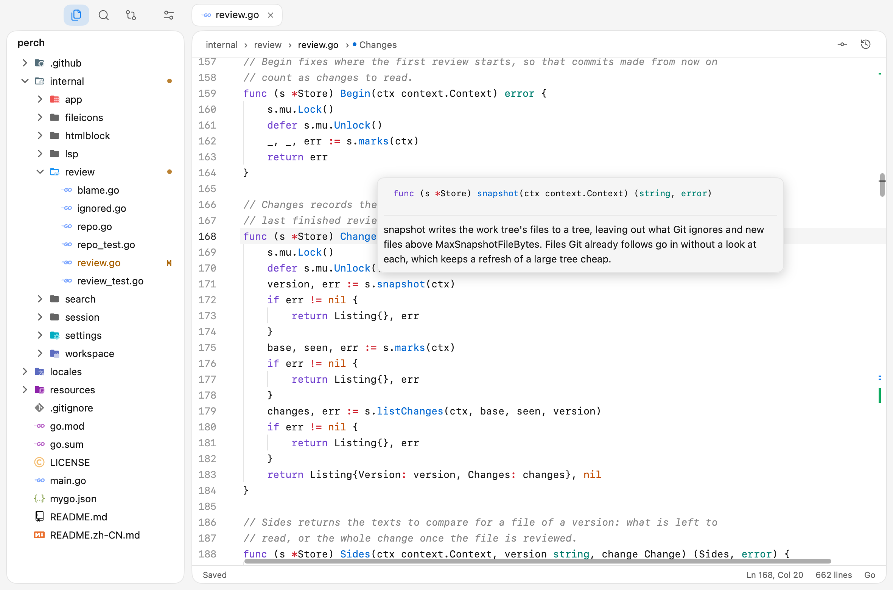

<p align="center">
  
</p>

<h1 align="center">Perch</h1>

<p align="center">
  A quiet place to read code while your agents work.
</p>

<p align="center">
  English · <a href="README.zh-CN.md">简体中文</a>
</p>

<p align="center">
  <picture>
    <source media="(prefers-color-scheme: dark)" srcset=".github/screenshots/perch-dark.png">
    
  </picture>
</p>

Perch is a lightweight native code viewer and light editor. When agents write most of the code, you still need somewhere to see what changed, read it closely and fix a line by hand, without opening a full IDE.

It is built in Go with [MyGo](https://github.com/egoist/mygo). The interface is drawn natively with Metal, with no webview.

## Features

- **Review what changed.** Perch remembers how far you have read, even after an agent commits. It lists the files left to read, shows their diffs, and marks unread lines beside the line numbers as they are written. It never touches your index, `HEAD` or branches.
- **Read comfortably.** Syntax highlighting, rendered Markdown including the HTML in READMEs, and previews of PNG, JPEG, GIF, WebP and SVG.
- **Edit safely.** If an agent rewrites a file you are editing, Perch asks which version to keep instead of overwriting either one.
- **Find your way.** Quick open, project search, find and replace, plus go to definition and a symbol list for the current file through language servers.
- **Manage files.** Create, rename and move files to the Trash from the file tree. Open tabs follow a rename and keep their unsaved edits, and files Git ignores are dimmed.
- **Pick up where you left off.** Each project reopens with its tabs, caret, scroll position and layout, and each project gets its own window.
- **Stay light.** Language servers start only when needed and exit when idle. Perch idles at about 52 MB on macOS.
- **English and Simplified Chinese**, with light and dark appearances.

## Build from source

Perch needs Go 1.27.4 or later. Git is needed for the review features. It is developed and tested on macOS on Apple silicon.

```sh
go tool mygo build
open build/darwin-arm64/Perch.app
```

Run the checks with:

```sh
go test ./...
golangci-lint run
```

## Keyboard shortcuts

| Action | Shortcut |
| --- | --- |
| Go to file, or `file:line` | `⌘P` |
| Find in file | `⌘F` |
| Find and replace | `⌥⌘F` |
| Search the project | `⇧⌘F` |
| Go to symbol in file | `⇧⌘O` |
| Go to definition | `F12` or `⌘`-click |
| Go back / forward | `⌃-` / `⌃⇧-` |
| Next / previous tab | `⌃Tab` or `⇧⌘]` / `⌃⇧Tab` or `⇧⌘[` |
| Tab 1 to 8 / last tab | `⌘1` to `⌘8` / `⌘9` |
| Toggle Markdown preview | `⇧⌘V` |
| Show changes | `⇧⌘R` |
| Mark file reviewed | `⌘↩` |
| Save / close tab | `⌘S` / `⌘W` |
| New window / open folder | `⇧⌘N` / `⌘O` |
| Settings | `⌘,` |

## Language servers

Go to definition works with any server that speaks the Language Server Protocol. Perch knows 22 languages out of the box. Open **Settings → Code Navigation → Language servers** to see which servers are installed, turn languages on or off, and copy install commands.

To add another language, choose **Open Configuration File** on that page and add an entry:

```json
{
  "languageServers": {
    "zig": {
      "name": "Zig",
      "extensions": [".zig"],
      "command": "zls",
      "args": [],
      "rootMarkers": ["build.zig"],
      "install": "brew install zls"
    }
  }
}
```

`command` must be a program name on your `PATH` or an absolute path. Perch reads this file only from your own settings folder and never runs a command named by an opened project.

## Work with your agent

Perch can be the screen for the coding agent in your terminal. The agent opens the code it is talking about, reads what you have selected, and walks you through a change one stop at a time. The conversation stays in your terminal.

Turn on what you want in **Settings → Agents → Manage**, or install everything for Claude Code with one line:

```sh
/Applications/Perch.app/Contents/MacOS/Perch setup
```

Use `--only tools,skill,command` to choose parts, `--status` to see what is installed, and `--remove` to take them away. During a walkthrough, `F8` and `⇧F8` move between stops.

## License

[MIT](LICENSE)
