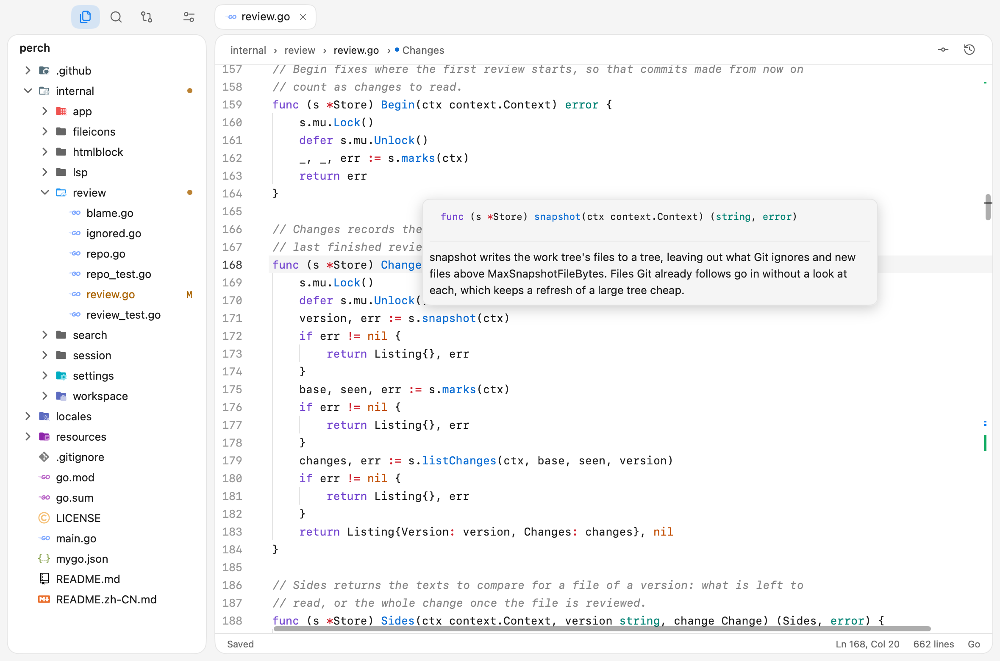

<p align="center">
  
</p>

<h1 align="center">Perch</h1>

<p align="center">
  在 agent 写代码时，安静地读代码。
</p>

<p align="center">
  <a href="README.md">English</a> · 简体中文
</p>

<p align="center">
  <picture>
    <source media="(prefers-color-scheme: dark)" srcset=".github/screenshots/perch-dark.png">
    
  </picture>
</p>

Perch 是一个轻量的原生代码查看器和轻量编辑器。当大部分代码由 agent 来写，你仍然需要一个地方看清改了什么、仔细读一读、顺手改一行，而不必打开完整的 IDE。

Perch 使用 Go 和 [MyGo](https://github.com/egoist/mygo) 构建，界面通过 Metal 原生绘制，没有 WebView。

## 功能

- **审阅改动：** Perch 记得你读到了哪里，agent 提交之后也不会丢。它列出还没读的文件，显示差异，并在行号旁实时标出未读的行。它不会动你的暂存区、`HEAD` 和分支。
- **舒服地阅读：** 语法高亮、渲染 Markdown（包括 README 里的 HTML），以及 PNG、JPEG、GIF、WebP 和 SVG 预览。
- **安全地编辑：** agent 改写了你正在编辑的文件时，Perch 会询问保留哪个版本，不会覆盖任何一方。
- **快速定位：** 快速打开、项目搜索、查找替换，以及通过语言服务跳转定义和列出当前文件的符号。
- **管理文件：** 在文件树里新建、重命名、移到废纸篓。重命名后，打开的标签页会跟着更新，未保存的修改也会保留。被 Git 忽略的文件会置灰显示。
- **接着上次继续：** 每个项目重新打开时恢复标签页、光标、滚动位置和布局，不同项目在各自的窗口中打开。
- **保持轻量：** 语言服务只在需要时启动，闲置后自动退出。在 macOS 上空闲内存约 52 MB。
- **支持英文和简体中文**，以及浅色和深色外观。

## 从源码构建

需要 Go 1.27.4 或更高版本，审阅功能需要 Git。目前在 Apple 芯片的 macOS 上开发和测试。

```sh
go tool mygo build
open build/darwin-arm64/Perch.app
```

运行检查：

```sh
go test ./...
golangci-lint run
```

## 快捷键

| 操作 | 快捷键 |
| --- | --- |
| 跳转到文件，或 `文件:行号` | `⌘P` |
| 在文件中查找 | `⌘F` |
| 查找和替换 | `⌥⌘F` |
| 搜索项目 | `⇧⌘F` |
| 跳转到文件中的符号 | `⇧⌘O` |
| 跳转到定义 | `F12` 或按住 `⌘` 点击 |
| 后退 / 前进 | `⌃-` / `⌃⇧-` |
| 下一个 / 上一个标签页 | `⌃Tab` 或 `⇧⌘]` / `⌃⇧Tab` 或 `⇧⌘[` |
| 第 1 到 8 个 / 最后一个标签页 | `⌘1` 到 `⌘8` / `⌘9` |
| 切换 Markdown 预览 | `⇧⌘V` |
| 显示改动 | `⇧⌘R` |
| 标记文件已审阅 | `⌘↩` |
| 保存 / 关闭标签页 | `⌘S` / `⌘W` |
| 新建窗口 / 打开文件夹 | `⇧⌘N` / `⌘O` |
| 设置 | `⌘,` |

## 语言服务

跳转定义支持任何遵循 Language Server Protocol 的语言服务，Perch 内置了 22 种语言。在 **设置 → 代码导航 → 语言服务** 里可以查看安装状态、开关语言、复制安装命令。

要添加其他语言，在该页面选择 **打开配置文件**，然后加入一段配置：

```json
{
  "languageServers": {
    "zig": {
      "name": "Zig",
      "extensions": [".zig"],
      "command": "zls",
      "args": [],
      "rootMarkers": ["build.zig"],
      "install": "brew install zls"
    }
  }
}
```

`command` 必须是 `PATH` 中的程序名或绝对路径。Perch 只从你自己的设置目录读取这个文件，不会运行所打开项目指定的命令。

## 和 agent 协作

Perch 可以成为终端里编程 agent 的屏幕。Agent 能打开它正在讲的代码，读取你选中的内容，并一处一处带你读完改动，对话始终留在终端里。

可以在**设置 → Agent → 管理**里按需打开，也可以用一行命令为 Claude Code 装好全部内容：

```sh
/Applications/Perch.app/Contents/MacOS/Perch setup
```

用 `--only tools,skill,command` 选择要装的部分，`--status` 查看安装情况，`--remove` 卸载。带读时按 `F8` 和 `⇧F8` 切换下一处和上一处。

## 许可证

[MIT](LICENSE)
